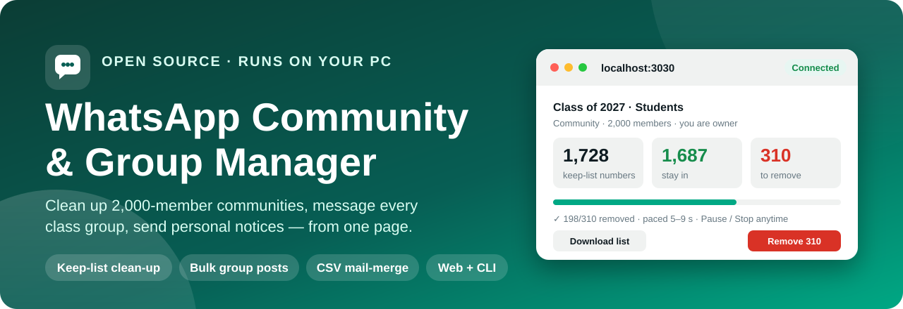
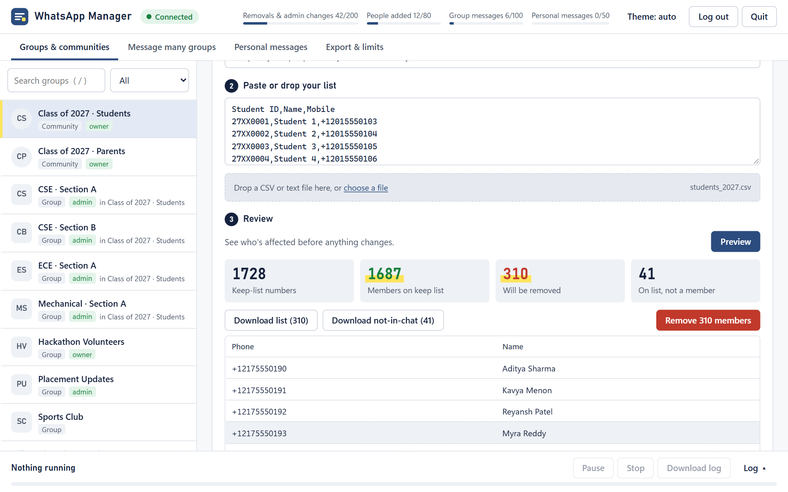
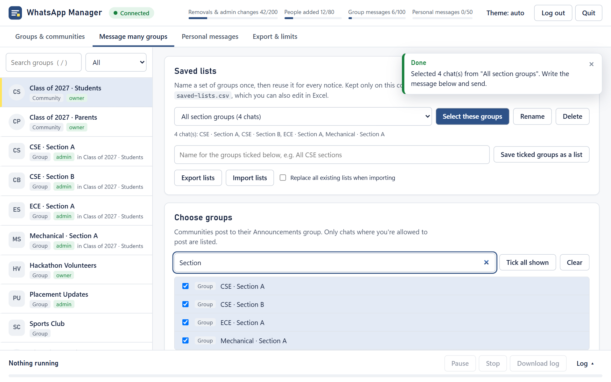
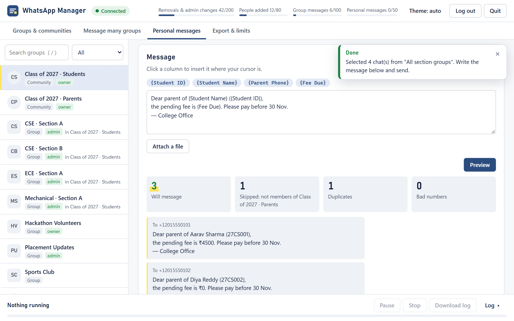
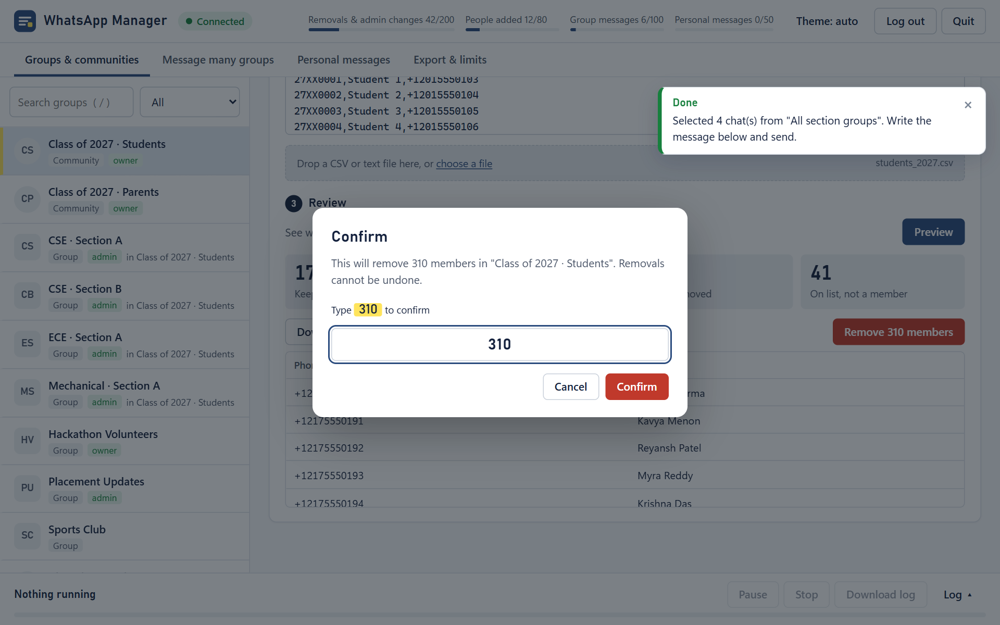
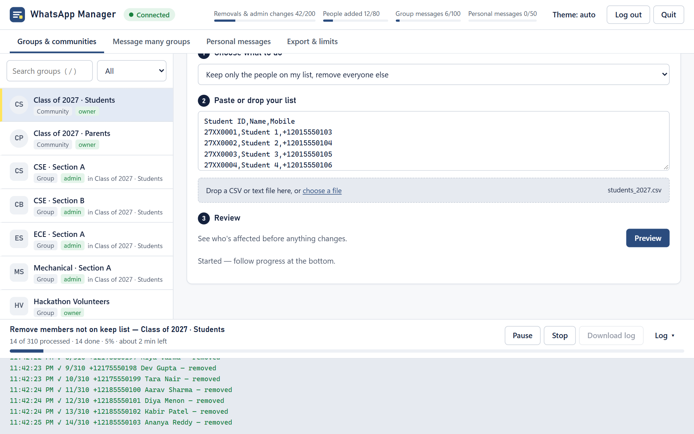
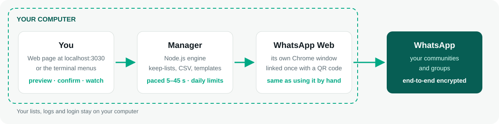

<p align="center">
  
</p>

<p align="center">
  <a href="LICENSE"></a>
  
  
  
  
</p>

<p align="center"><b>Run a 2,000-member WhatsApp community without spending your evenings in "Group info".</b><br>
Free, open source, and it runs on your own computer: no cloud account, no subscription.</p>

---

## Why people use it

Running a college batch, a club or an alumni network on WhatsApp means hours of tapping through members one at a time. This tool does the repetitive parts for you:

- 🧹 **Keep-list clean-up.** Upload your student list and it removes everyone else. Admins are never touched.
- 📣 **One post, many groups.** Send the same notice, photo or PDF to every section group at once.
- 🗂️ **Saved group lists.** Save sets like "All CSE sections" or "Every Announcements" once, then reuse them. They're kept in a local CSV you can edit in Excel.
- ✉️ **Personal messages from a spreadsheet.** For example `Dear parent of {Student Name}, the pending fee is {Fee Due}`.
- 👮 **Bulk admin changes.** Make admins, remove admins, add or remove people from a list.
- 📊 **Export everything.** Every member's number, and every group you're in, as CSV.

It works through **WhatsApp Web, at a human pace, with daily limits**. Nothing happens until you've seen a preview and **typed the exact count** to confirm.

<p align="center">
  <picture>
    <source media="(prefers-color-scheme: dark)" srcset="docs/manage-dark.png">
    
  </picture>
  <br><sub>Paste or upload your list, then <b>Preview</b>: see exactly who stays and who goes, before anything happens.</sub>
</p>

### Try it in 30 seconds, no WhatsApp needed

```powershell
git clone https://github.com/anilreddykota/wa-community-cli; cd wa-community-cli; npm install; npm run demo
```

Then open <http://localhost:3031>. **Demo mode** uses made-up data and never connects to WhatsApp, so you can click everything.

---

## Quick start (Windows, no technical knowledge needed)

**1. Install Node.js (one time).**
Go to <https://nodejs.org>, download the **LTS** version, and install it with the default options.

**2. Download this tool.**
On this page click the green **Code** button → **Download ZIP**. Unzip it anywhere, e.g. your Documents folder.

**3. Start it.**
Open the unzipped folder and double-click **`start-ui.bat`**.
- The first time, it installs what it needs. This takes about a minute.
- Your browser then opens at **http://localhost:3030**.
- A separate Chrome window opens WhatsApp Web.

**4. Link WhatsApp (one time).**
On your phone, open WhatsApp → **Linked devices** → **Link a device**, and scan the QR code shown on the page.

That's it. Next time, just double-click `start-ui.bat` again. No QR code needed.

> Keep the black `start-ui.bat` window open while you use the tool. Closing it, or clicking **Quit** on the page, stops the tool.

**Mac / Linux:** install Node.js, then run `sh start-ui.sh` in the folder.

---

## Using the page

| Where | What you can do |
|---|---|
| **Left side** | Search all your groups and communities. Filter to communities, groups, or ones where you're admin. Click one to manage it. |
| **Manage** | Member list and search. **Export members CSV**. **Bulk member action**: remove everyone not on a keep list, remove listed numbers, or make or remove admins. Paste numbers or load a CSV, click **Preview** to see exactly who is affected, then confirm. **Add members**: paste or load numbers, preview who's new, confirm. **Post a message** to that group, or to a community's Announcements. |
| **Message many groups** | Pick a **saved list**, or tick groups yourself, then write a message, optionally attach a photo, video or document, and send. Communities post to their Announcements group. Click **Save selection as list** to reuse the same set next time. |
| **Personal messages** | Load a CSV with a header row and pick the phone column. Choose who can receive messages: **members of a group** (safer), or **anyone in the CSV** (no group check; shows a risk warning and needs an extra tick). Write the message, using buttons like `{Student ID}` to fill in each row's data. Preview, tick the confirmation, then send. |
| **Export & limits** | Export a list of all your groups. See today's usage. |
| **Bottom bar** | Live progress, **Pause**, **Stop**, and **Download log** for the running job. |
| **Top right** | **Log out** (disconnect WhatsApp from this computer) and **Quit** (stop the tool). |

Number lists can be any CSV or text file. Every phone-number cell is read; names, IDs and headers are ignored. 10-digit numbers get the country code (91) added. Your files never leave your computer: everything runs locally.

Before anything is removed, changed or sent, the tool asks you to **type the exact number of people**.

### Screenshots

<table>
  <tr>
    <td width="50%">
      <picture>
        <source media="(prefers-color-scheme: dark)" srcset="docs/broadcast-dark.png">
        
      </picture>
      <p align="center"><b>One notice → every section group</b><br><sub>Tick the groups, attach the timetable, send.</sub></p>
    </td>
    <td width="50%">
      <picture>
        <source media="(prefers-color-scheme: dark)" srcset="docs/personal-dark.png">
        
      </picture>
      <p align="center"><b>Mail-merge from a spreadsheet</b><br><sub>Each parent gets their own child's details. Preview first.</sub></p>
    </td>
  </tr>
  <tr>
    <td width="50%">
      <picture>
        <source media="(prefers-color-scheme: dark)" srcset="docs/confirm-dark.png">
        
      </picture>
      <p align="center"><b>No accidents</b><br><sub>You type the exact count before anything changes.</sub></p>
    </td>
    <td width="50%">
      <picture>
        <source media="(prefers-color-scheme: dark)" srcset="docs/progress-dark.png">
        
      </picture>
      <p align="center"><b>Live progress, Pause and Stop</b><br><sub>Human-paced, with a log you can download.</sub></p>
    </td>
  </tr>
</table>

<sub>Screenshots are from demo mode, with made-up names and +1 555-01xx numbers (a range reserved for fiction). Regenerate them with `npm run screenshots`.</sub>

### Saved group lists

A saved list is a named set of groups and communities, for example "All CSE sections" or "Every class Announcements". Send to it again any time, without ticking groups one by one.

- **Web page:** on **Message many groups**, tick the groups, type a name and click **Save selection as list**. Next time, pick it and click **Select these**. You can also **Rename**, **Delete**, **Export** or **Import** lists there.
- **Terminal:** when sending to many groups, choose a saved list or pick groups and give them a name. **Saved group lists** in the main menu shows, renames and deletes lists.
- **Storage:** lists live in `saved-lists.csv` in the tool's folder, only on your computer. You can open and edit it in Excel:

```csv
list,title,kind,chat_id
All CSE sections,CSE · Section A,group,120363…@g.us
All CSE sections,CSE · Section B,group,
Every Announcements,Class of 2027 · Students,community,
```

`chat_id` is filled in automatically when you save from the tool. For rows you type yourself, `list` and `title` are enough: the tool finds the group by its exact name. If a name isn't found or appears twice, the tool skips that row and tells you, so nothing goes to the wrong group.

### How it works

<p align="center"></p>

The tool drives WhatsApp Web in its own Chrome window, the same way you would by hand, only paced and repeatable. There's no server in the middle and no account to create. Your lists, logs and login stay on your computer.

## Disconnecting WhatsApp

- **On the page:** click **Log out**. This closes the WhatsApp window and deletes the saved login on this computer.
- **On your phone:** WhatsApp → **Linked devices** → tap **Google Chrome (Windows)** → **Log out**. Do this as well to fully remove the connection.

## Pace and daily limits

WhatsApp doesn't allow automated or bulk use of personal accounts. It watches for unusual activity and acts on reports from recipients. No tool can make automation "approved". This one keeps activity human-paced to lower the risk:

| Kind | Gap between items | Break | Daily limit |
|---|---|---|---|
| Removals and admin changes | 5–9 s | 90 s every 25 | 200 |
| Adding people | 15–30 s | 5 min every 10 | 80 |
| Group messages | 10–20 s | 2 min every 20 | 100 |
| Personal messages | 20–45 s | 5 min every 10 | 50 |

When a limit is reached, the rest waits for the next day. To change the limits, create a file named `config.json` in the folder, for example:

```json
{ "countryCode": "91", "pace": { "dms": { "dailyLimit": 30 }, "adds": { "dailyLimit": 50 }, "members": { "dailyLimit": 150 } } }
```

**What gets numbers banned:** messaging people who don't expect it, sending the same text to many people, and adding strangers to groups.
- For announcements, post **once** in the community's Announcements group instead of messaging everyone separately.
- If WhatsApp shows any warning, the tool stops. Wait at least a day.

## Safety built in

- The owner, admins and members with hidden numbers are never removed.
- Community removals go through WhatsApp's own confirm box, and the tool checks it names the right number first.
- Every change and message waits for WhatsApp to confirm it. The run stops on the first error.
- **Adding people** and **personal messages** each need you to tick a box confirming the people know you and expect it. The tool checks this too, so it can't be skipped.
- Personal messages go only to members of a group you pick, unless you choose "anyone in my CSV". That option needs a second confirmation about the extra risk. Duplicates are always removed.
- The page only works on your own computer (`localhost`). It's protected by a secret key, so other websites can't control it.

## Two versions: web page and terminal

| | Web page | Terminal |
|---|---|---|
| Start (Windows) | double-click `start-ui.bat` | double-click `start-terminal.bat` |
| Start (any OS) | `npm run ui` | `npm start` |
| Use it with | your browser, at http://localhost:3030 | keyboard menus: type to search, arrows, Enter |

Both have the same features and share the same WhatsApp login and daily limits. Only **one can run at a time**. If you start the second one, it tells you to close the first.

## Chrome extension

[`extension/`](extension/) adds a simple **Community Cleaner** button inside your normal WhatsApp Web, for export and keep-list removal only. See [extension/README.md](extension/README.md).

## For developers

```powershell
npm install
```

| Command | What it does |
|---|---|
| `npm run ui` | web version |
| `npm start` | terminal version |
| `npm run demo` | web UI with made-up data, no WhatsApp |
| `npm run screenshots` | regenerate the README images from demo mode |

Where the code lives:
- `server.mjs`: local web server
- `public/index.html`: the page
- `index.mjs`: terminal version
- `lib/engine.mjs`: shared logic
- `lib/inpage.js`: the part that runs inside WhatsApp Web

Pull requests are welcome, especially fixes for WhatsApp Web updates.

## What's tested on a live account

| Feature | Status |
|---|---|
| Listing groups and communities, your role, where you can post | ✅ |
| Loading full member lists (including 2,000-member communities) | ✅ |
| Export, keep-list compare, CSV parsing, placeholders | ✅ |
| Removing from a community | ✅ (300+ removals) |
| Removing from, adding to, and posting in a normal group | ✅ |
| Make and remove admin in a normal group | ✅ |
| Sending text, photo and PDF | ✅ |
| Make or remove admins in a **community** | ⚠️ not run live yet; try one number first |
| Adding people to a **community** (through its Announcements group) | ⚠️ not run live yet; try one number first |
| Invite links in the export | ⚠️ only for groups whose "Invite via link" screen you've opened once |

## Troubleshooting

When something goes wrong, the page shows a **red message at the top right** saying what happened and what to do. It stays until you close it. Warnings, such as "2 people couldn't be added because of their privacy settings", show in amber. Every message is also kept in the log at the bottom.

- **The QR code won't scan:** scan the code in the separate WhatsApp Chrome window instead, or click **Connect WhatsApp** to get a fresh one.
- **"Chrome not found":** install Google Chrome, or set the `CHROME_PATH` environment variable to your `chrome.exe`.
- **Something stopped working after a WhatsApp update:** the tool relies on WhatsApp Web's internal code (`lib/inpage.js`), which WhatsApp can change. Check for an updated version of this tool.

## Disclaimer

This is an unofficial tool. It isn't affiliated with or endorsed by WhatsApp or Meta. Automating a personal WhatsApp account is against WhatsApp's Terms of Service and can get the number restricted or banned. Use it at your own risk, only for groups you manage, and only to message people who expect to hear from you.

## License

[MIT](LICENSE). Free to use, change and share.

---

<p align="center"><b>If this saved you an evening of tapping through "Group info", give it a ⭐ and share it with another group admin.</b></p>
